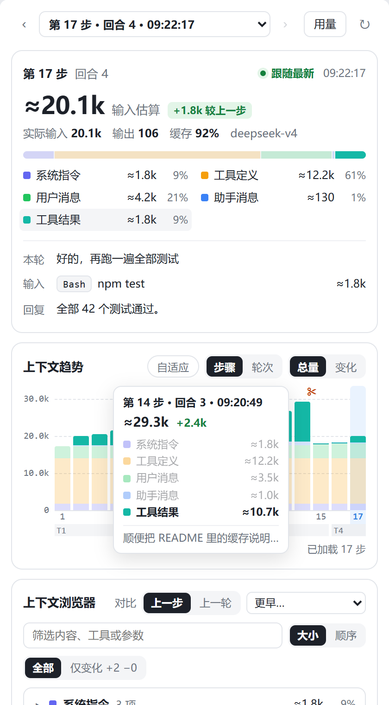
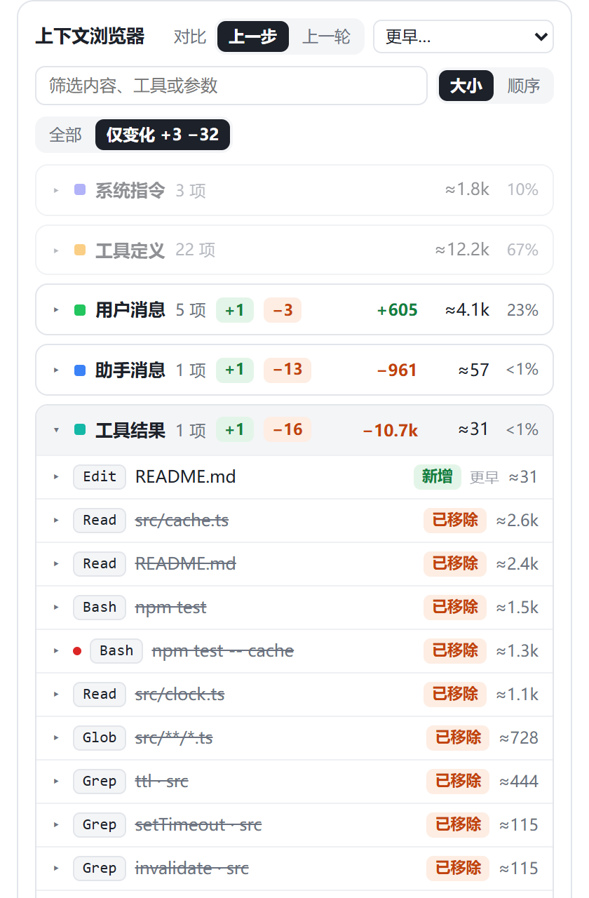
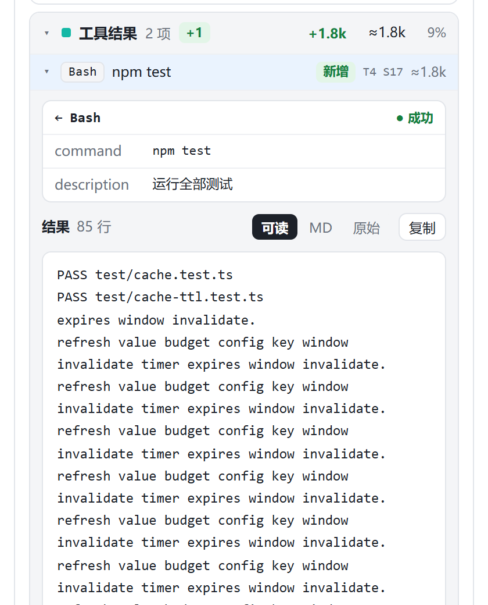
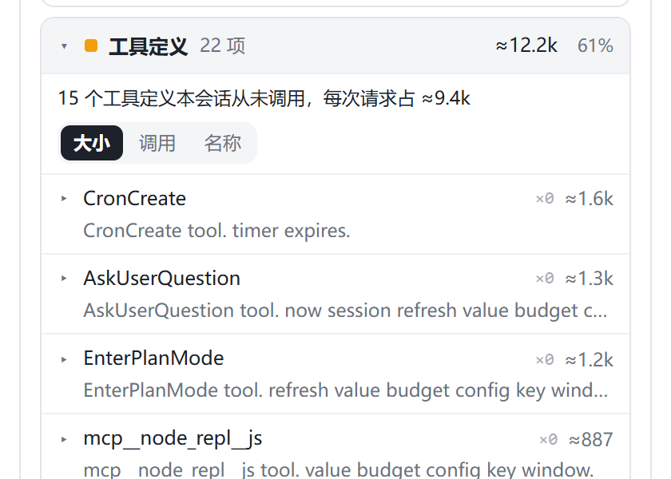
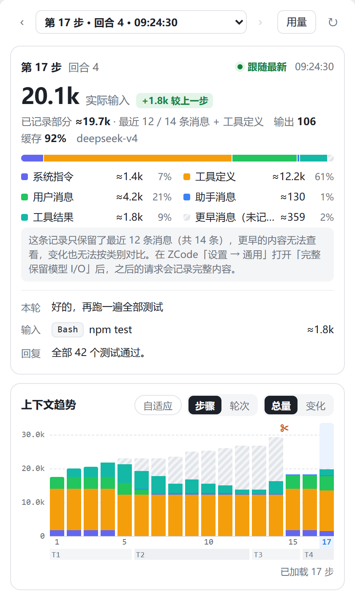

# ZCode Context

[简体中文](README.md)

See your context from the ZCode session side pane: what each request carried, which kind of content takes the most room, what entered at this step, and what a compaction removed.

An independent, read-only, offline ZCode UI plugin for Desktop local workspaces.

<p>
  
  
</p>

## What it answers

- **Why is the context this big?** Each request's size, its composition by category (system prompt, tool schemas, user, assistant, tool results) and the trend over steps.
- **What entered at this step?** Everything that entered after the previous reply, usually tool results, with their arguments and bodies one click away.
- **Which tool schemas cost tokens for nothing?** How often this session called each tool, and how much the never-called schemas cost on every request.
- **What did a compaction remove?** Logged compaction events, before/after navigation and the removed items (requires complete recording, see below).
- **How long has something been in context?** Each message shows the turn and step it entered.

## Layout

| Area | Contents |
|---|---|
| Step selector | ‹ › or ←/→ move between agent requests; the menu also lists title and compaction requests. Follows the latest request, pauses while you read an expanded element, and tells you how many newer requests arrived when you look at history |
| Request summary | Size, change versus the previous step, actual input/output/cache, a category bar and legend, and a Turn / In / Reply brief |
| Context trend | One bar per agent request with an axis, a turn band and ✂ compaction markers; Total/Delta, Steps/Turns, Adaptive scaling; hover for per-category values, and hovering a category highlights it everywhere |
| Context browser | Collapsible, paged categories; compare with the previous step, the previous turn or any earlier step; Changes mode shows only additions and removals; elements are named by tool and key argument, such as `Read · src/cache.ts` |
| Element details | Inline tool cards (argument table, OK/error), schema parameter tables and bodies (readable / Markdown / raw, copy, find, parts) |
| Compaction events | Logged kind, status, reason and savings, with before/after step navigation |
| Usage | Secondary page with 30-day logical usage, daily totals and recent requests |

<p>
  
  
</p>

## Default recording versus complete retention

By default ZCode records only the **latest 64 messages** of each request; a long session's request often has several hundred. The plugin keeps the two cases apart:

| | Default | Complete Model I/O retention |
|---|---|---|
| Request size | Provider-reported actual input; the recorded part is marked and the rest is shown hatched as "earlier messages (not recorded)" | Full category estimate |
| Composition by category | Recorded messages and tool schemas only | Complete |
| In row, additions | Available (derived from entry stamps) | Available |
| Removals, per-category change | Unknown, and the panel says so | Available |
| Body Diff of a replacement | Not available | Available for uniquely identified tool results and schemas |
| Tool call counts, entry stamps | Available | Available |



For complete comparisons, turn on complete Model I/O retention in ZCode Settings → General. It uses more disk space, applies to later requests only and cannot restore records already discarded; the plugin never changes this setting.

## Install

### Prerequisites

- ZCode Desktop (baseline 3.15.1 with the official UI plugin contract).
- Node.js 24+ on PATH. `node -v` printing a version is enough — it only starts the plugin's bundled service; no npm or build tools are needed.

### From the plugin marketplace (recommended)

1. Open ZCode's **Settings → Plugin Management** and switch to the **Discover** tab.
2. Click the **`+`** button to add a marketplace.
3. Enter this project's GitHub repository `Kevinzzz6/zcode-context` (the full URL `https://github.com/Kevinzzz6/zcode-context` also works) and confirm; `zcode-context-marketplace` appears in the marketplace list.
4. Find the **zcode-context** card in the plugin list and click **Get**. The button turns to **Installed** when done; the plugin is enabled by default.
5. Restart ZCode.
6. Open any session, click **`+`** in the right pane to add a tab, and choose **Context**.

No cloning and no npm commands are involved. The plugin installs into ZCode's local cache with its bundled service dependencies, worker and offline page; it does not need the source checkout at runtime. Uninstall and the on/off switch live in the plugin's detail view on the **Installed** tab.

> Adding the marketplace makes ZCode clone from GitHub. If your network needs a proxy, set the `ZCODE_HTTP_PROXY` environment variable (for example `http://127.0.0.1:7890`) and restart ZCode — ZCode reads only this variable, not `http_proxy`.

### Updating

In **Settings → Plugin Management → Discover**, refresh the `zcode-context-marketplace` source; when the zcode-context card offers **Update**, click it and restart ZCode. The current version is shown in the plugin's detail view on the **Installed** tab.

### Offline install

When GitHub is unreachable, use the release archive instead:

1. Download `zcode-context-<version>-marketplace.zip` for the version you want from [Releases](https://github.com/Kevinzzz6/zcode-context/releases); the matching `.sha256` file verifies it.
2. Unzip it anywhere; you get a `zcode-context-marketplace` directory.
3. Add a marketplace via **Plugin Management → Discover → `+`** choosing a local directory, pointing at the unzipped `zcode-context-marketplace` directory (the one containing `marketplace.json`).
4. Get, enable and restart as in steps 4–6 above.

### From source (developers)

```sh
git clone https://github.com/Kevinzzz6/zcode-context.git
cd zcode-context
npm ci
npm run build
```

The build writes `marketplace.json` and `plugins/zcode-context/` at the repository root, so the repository root itself becomes a marketplace directory. Add it in **Plugin Management → Discover → `+`** as a local directory using the repository's absolute path. After changing code, rebuild, then refresh and update the plugin in the marketplace. See **Development** below for the full verification flow.

### About approving two read-only tools

Enabling the plugin only makes ZCode load it. The panel reads data by calling two tools provided by the plugin, and ZCode applies its normal tool permission rules to them:

- `mcp__plugin_zcode-context_context__get_context_summary`: overview and trend, polled every 3 seconds while data changes and slowing to 10 seconds while it stays unchanged
- `mcp__plugin_zcode-context_context__get_context_request`: a step's content, comparison and bodies

Both are read-only and callable only by the panel; the model never sees them. If the panel keeps showing "Loading…" or "This is taking a while", allow these two tools in ZCode (approvals are saved per project). The plugin never changes permissions itself.

## Reading the numbers

- **Estimates** use about 4 serialized characters per token for English and code and about 1.5 for Chinese, Japanese and Korean, to compare size and change; they are not the model's tokenization. Values with "≈" are estimates.
- **Actual input** is the provider-reported input of the request, including cache reads.
- **Step and turn numbers** count from the first readable record, not from the start of the session. ZCode periodically resets long sessions' record files; history then starts over, and the trend says so.
- **Entry stamps `T2 S7`** are traced by absolute message position. A message still present where tracing stops (oldest loaded record, a gap, a reset or a compaction) shows "earlier" instead of a guessed step.
- **Tool call counts** cover the whole session, including calls after the selected step and calls already compacted away. Without the call records they are unknown, never ×0.
- **Compaction** is taken from logs only, for the last 3 days. A drop in size does not prove a compaction, and no logged event does not prove there was none.
- **Usage** comes from ZCode's logical request statistics, including title and compaction calls, and is counted separately from the trend's records.
- The panel stays with the session that opened it, even when another session in the workspace sends messages.

## Privacy and safety

- Read-only: no changes to ZCode code, settings, databases or permissions; no migrations; read-only database connections.
- Offline: no network access, no model calls; data stays on the machine.
- Every read binds to the session identity passed by the host; without a valid identity it fails explicitly and never reads another session.
- Captured HTML is never executed; bodies render as text or restricted Markdown.

## Configuration

Defaults read `db/db.sqlite`, `rollout/`, `debug/` and `log/` under `~/.zcode/cli`. Use **dataRoot** in the plugin settings for another CLI data directory, and **dbPath** when the database lives elsewhere. Both must be absolute; `~/` is expanded.

## Development

```sh
npm ci
npm run check        # syntax and manifest checks
npm test             # unit tests
npm run build        # dist/, plugins/zcode-context/ and the root marketplace
npm run smoke        # built service over real MCP stdio
npm run verify       # all of the above, results in output/verification
```

| Command | Purpose |
|---|---|
| `npm run fixture:ui` | Synthetic multi-turn session (tool calls, a title request, an automatic compaction) at http://127.0.0.1:4175; `FIXTURE_TAIL=12` mimics default tail recording; `/append?session=sess_A` simulates a new request |
| `npm run preview:session -- <sessionId>` | Read-only preview of a real session through the built service at http://127.0.0.1:4177, without installing the plugin |
| `npm run preview` | Demo data at http://127.0.0.1:4173/?demo=1 |
| `npm run fixture:browser` + `npm run test:browser -- <absolute path to playwright/index.mjs>` | Browser interaction regression (25 groups) with existing Playwright and local Chrome; nothing is downloaded |

The browser test covers the official App/AppBridge handshake, real stdio/SQLite and two-session isolation, but does not replace acceptance in the ZCode desktop side pane.

## Status

- 0.3.x has been checked against a real session (about 600k tokens, default recording) in the read-only preview; unit and browser tests pass.
- Acceptance in the ZCode desktop side pane is still pending for 0.3.x; 0.2.0 had basic Electron integration evidence.
- Upstream storage format changes may require adapter updates.

## Documents

- [Changelog](CHANGELOG.md)
- [Architecture](docs/architecture.md)
- [Handoff and next steps](docs/handoff.md) (Chinese)
- [Desktop acceptance](docs/desktop-acceptance.md) (isolated ZCode copies only)
- [Verification](docs/verification.md)
- [Comparison with dsh-context](docs/dsh-comparison.md) (Chinese)

## License

MIT. The implementation is original; the product direction was inspired by [dsh-context](https://github.com/bowenliang123/dsh-context).
