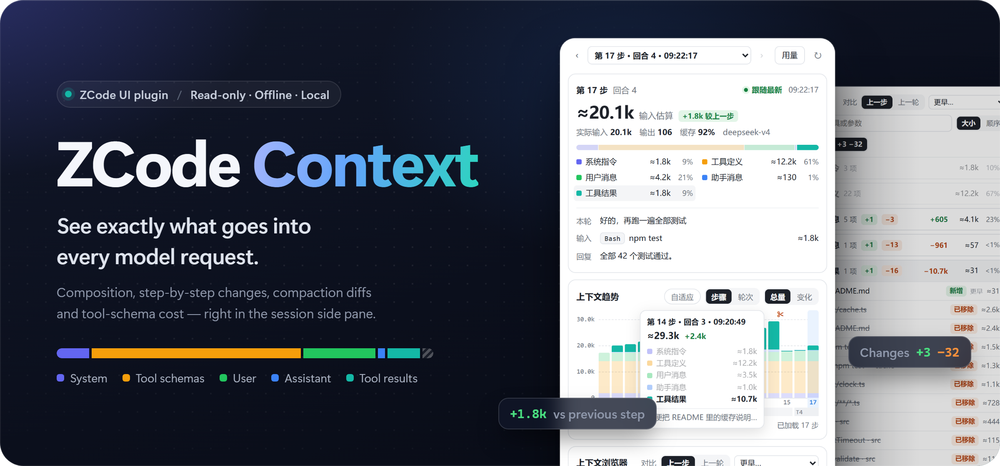
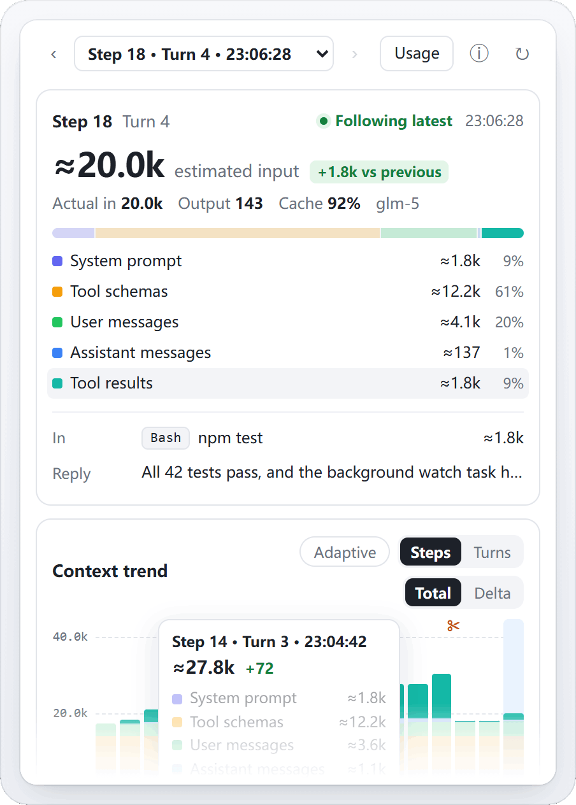
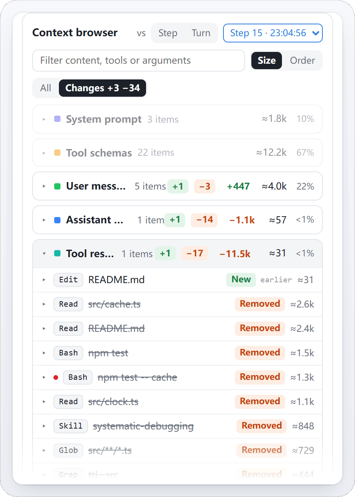
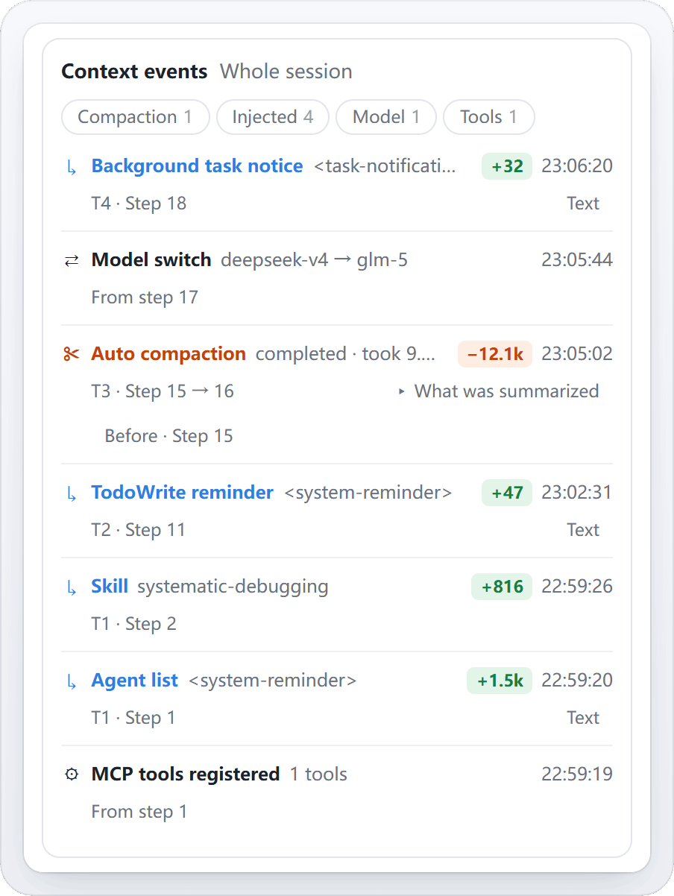
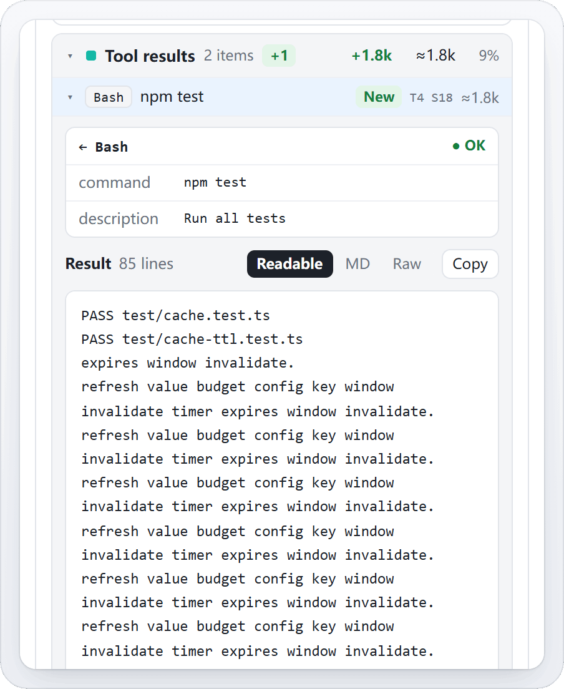
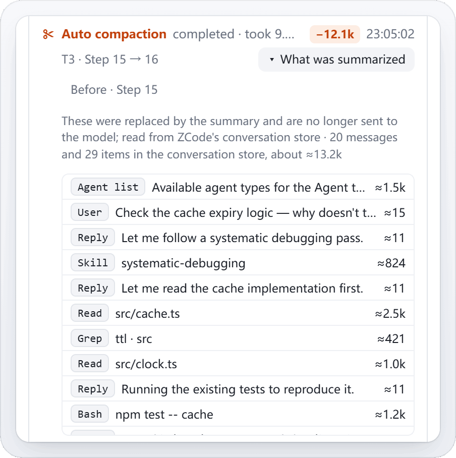
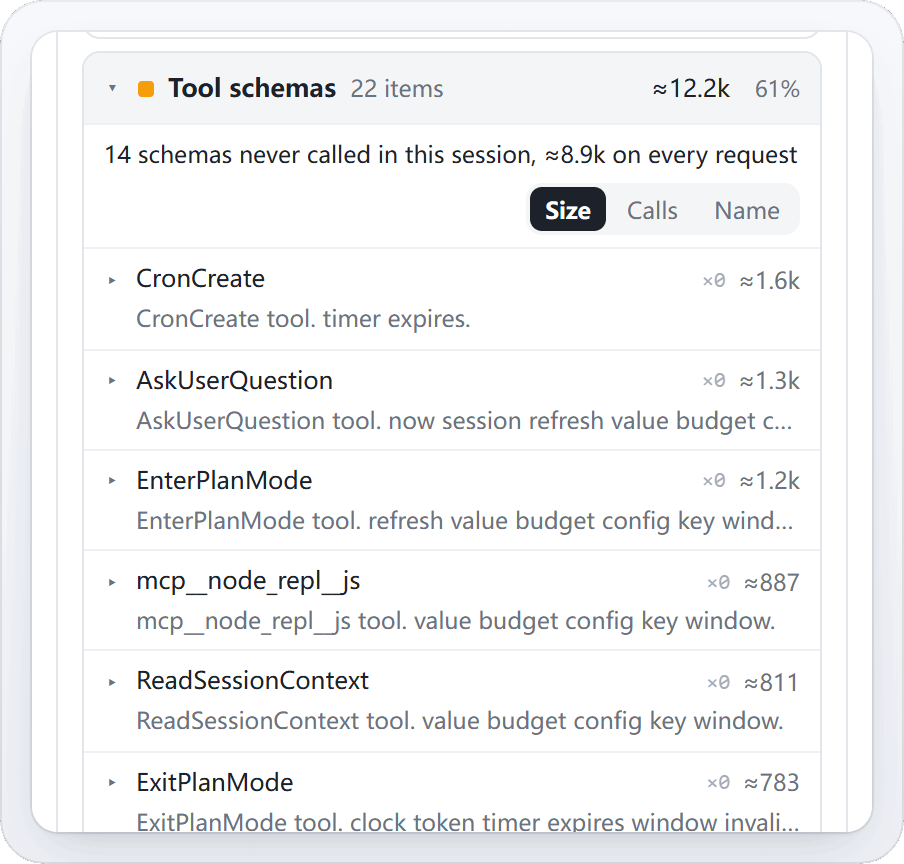
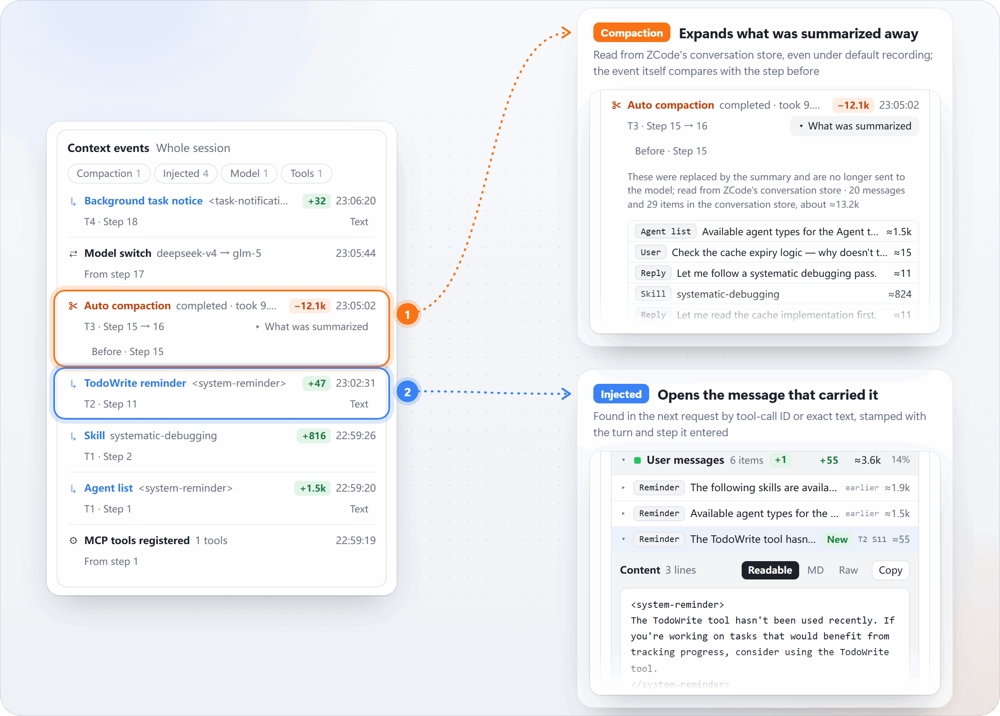
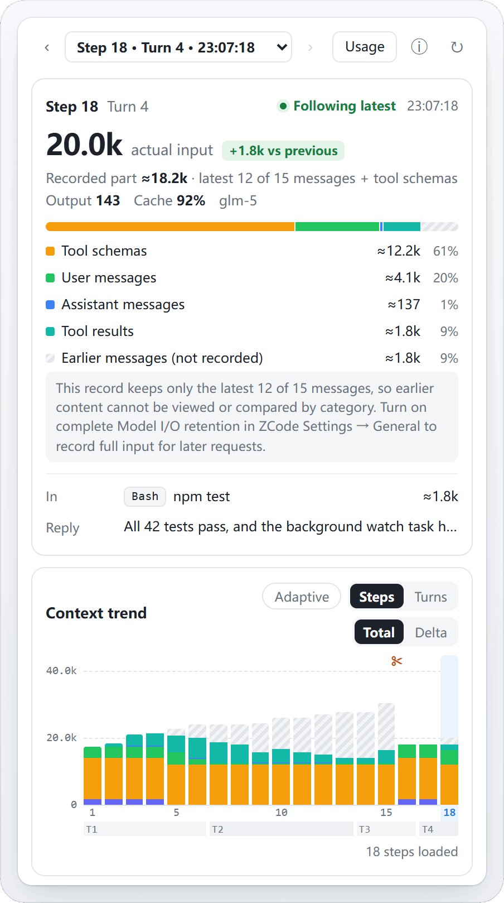
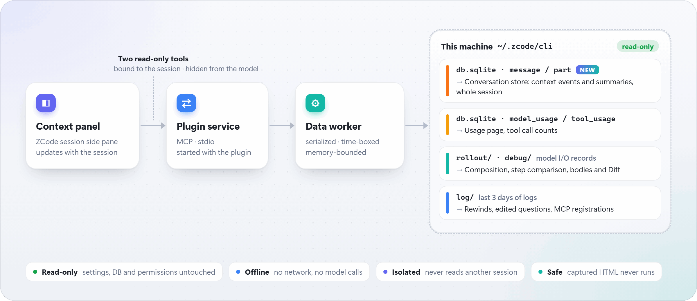

<a name="readme-top"></a>

<div align="center">



<br>
<br>

**See the context of every request, right in the ZCode session side pane**<br>
<sub>What each request carried · Which content takes the most room · What entered at this step · What the runtime injected · What a compaction summarized away</sub>

<br>

<a href="https://github.com/Kevinzzz6/zcode-context/releases"></a>
<a href="https://github.com/Kevinzzz6/zcode-context/actions/workflows/ci.yml"></a>


<a href="LICENSE"></a>

<br>

[Features](#what-it-answers) &nbsp;·&nbsp; [Context events](#context-events) &nbsp;·&nbsp; [Install](#install) &nbsp;·&nbsp; [Reading the numbers](#reading-the-numbers) &nbsp;·&nbsp; [How it works](#how-it-works-and-privacy) &nbsp;·&nbsp; [Development](#development) &nbsp;·&nbsp; [**简体中文**](README.md)

</div>

<br>

> [!TIP]
> **New in 0.3.6: Context events.** Injections, compactions and model switches are now read from ZCode's conversation store and cover the whole session, not just the last 3 days of logs. Click an event to open the item it brought into the context; a compaction also expands **What was summarized**, even under default recording. [See how it works ↓](#context-events)

An independent, read-only, offline ZCode UI plugin for Desktop local workspaces. It never touches the network, never calls a model and never changes a ZCode setting; it turns what ZCode already records on your machine into a side pane that updates with the session.

## What it answers

<table>
  <tr>
    <td width="50%" valign="top">
      <picture>
        <source media="(prefers-color-scheme: dark)" srcset="docs/images/frame-overview.en.dark.png">
        
      </picture>
      <h4>Why is the context this big?</h4>
      Each request's size, its composition by category (system prompt, tool schemas, user, assistant, tool results) and the trend over steps. Hover a category and it lights up everywhere.
    </td>
    <td width="50%" valign="top">
      <picture>
        <source media="(prefers-color-scheme: dark)" srcset="docs/images/frame-changes.en.dark.png">
        
      </picture>
      <h4>What did a compaction remove from the request?</h4>
      Clicking a compaction selects the step after it and compares it with the step before; Changes mode lists only additions and removals, with removed items struck through (requires complete recording, see <a href="#default-recording-versus-complete-retention">below</a>).
    </td>
  </tr>
  <tr>
    <td width="50%" valign="top">
      <picture>
        <source media="(prefers-color-scheme: dark)" srcset="docs/images/frame-events.en.dark.png">
        
      </picture>
      <h4>What did the runtime slip into the context? <sup>New</sup></h4>
      TodoWrite reminders, the agent list, background task notices and Skill loads — content you never wrote — one row each, with an estimated size and the step it entered. Compactions, model switches and MCP registrations share the same timeline.
    </td>
    <td width="50%" valign="top">
      <picture>
        <source media="(prefers-color-scheme: dark)" srcset="docs/images/frame-tool-card.en.dark.png">
        
      </picture>
      <h4>What entered at this step?</h4>
      Everything that entered after the previous reply, usually tool results, with their arguments and bodies one click away. Each message also shows the turn and step it entered, such as <code>T4 S18</code>.
    </td>
  </tr>
  <tr>
    <td width="50%" valign="top">
      <picture>
        <source media="(prefers-color-scheme: dark)" srcset="docs/images/frame-summarized.en.dark.png">
        
      </picture>
      <h4>What did a compaction summarize away? <sup>New</sup></h4>
      Tokens before and after, duration and the number of summarized messages; expand <b>What was summarized</b> to list every prompt, reply, reasoning block and tool call that was replaced by the summary and is no longer sent to the model.
    </td>
    <td width="50%" valign="top">
      <picture>
        <source media="(prefers-color-scheme: dark)" srcset="docs/images/frame-schemas.en.dark.png">
        
      </picture>
      <h4>Which tool schemas cost tokens for nothing?</h4>
      How often this session called each tool, and how much the never-called schemas cost on every request. Sort by size, calls or name.
    </td>
  </tr>
</table>

## Context events

<p align="center">
  <picture>
    <source media="(prefers-color-scheme: dark)" srcset="docs/images/events-flow.en.dark.png">
    
  </picture>
</p>

Plenty of what sits in the context was written neither by you nor by the model: ZCode's runtime adds or replaces it between requests. The **Context events** card lists these changes in time order, and each one opens to show exactly what it did to the context.

| Event | What the card shows | Clicking it |
|---|---|---|
| ↳ **Injected** | TodoWrite reminders, the agent list, restored context, background task notices, subagent messages and Skill loads, one row each with an estimated size | Opens the message that carried it in the context browser, stamped with the turn and step it entered; when that request is no longer readable, shows the text from the conversation store |
| ✂ **Compaction** | Status (completed, failed, in progress, retrying, interrupted or skipped), duration, tokens before and after, summarized message count | Selects the step after it and compares it with the step before; **What was summarized** lists the summarized prompts, replies, reasoning and tool calls |
| ⇄ **Model switch** | Which model was replaced by which | Selects the first step after the switch, where the request summary shows the new model |
| ↶ **Rewind / edited question** | Messages kept | Selects the first step after it and compares it with the step before |
| ⚙ **MCP tools registered** | Number of tools registered | Selects the first step after it and shows only its `mcp__` tool schemas, as a temporary focus you can leave; your own filter is paused and comes back |

- **Where events come from**: injections, compactions and model switches are read from the conversation store in ZCode's database (the `message` and `part` tables) for the whole session, and the card says **Whole session**. Reads are incremental and extract only the JSON fields needed, so large tool outputs never reach the plugin. Rewinds, edited questions and MCP registrations exist only in the logs and therefore cover the last 3 days; compactions the store has no record of (a failed attempt, say) are kept from the logs too. If the conversation store is unreadable, the whole card falls back to the logs and says **Last 3 days**.
- **How they are located**: an injection is sent to the model with the next request; the plugin finds it there by tool-call ID or exact text and opens it even beyond its category's first page. Clicking an event older than the loaded steps loads earlier steps first; if it still cannot be located the panel says so instead of settling on a nearby step.
- **Following the active branch**: a rewind deletes nothing from ZCode's conversation store, so **What was summarized** lists only messages on the current branch; a compaction that is itself on a rewound branch says its contents cannot be determined.
- **How they are merged**: ZCode logs a compaction's start and completion separately; they become one row with the final status. An edited question and the rewind it triggers merge the same way.
- **How to filter**: when more than one kind is present, kind filters appear under the title; the list shows the latest 12 with **Show all** for the rest. The ✂ and ↶ markers in the trend behave like their events.

> [!NOTE]
> Under default recording, model I/O records keep only a trailing window of each request's messages plus later deltas, so the full content of the step before a compaction is usually gone. **What was summarized** is then the only view of what a compaction removed: it comes from the conversation store and does not depend on the Model I/O retention setting.

## Layout

From top to bottom:

<table>
  <tr><th align="left">Area</th><th align="left">Contents</th></tr>
  <tr><td nowrap><b>Step selector</b></td><td><kbd>‹</kbd> <kbd>›</kbd> or <kbd>←</kbd> <kbd>→</kbd> move between agent requests; the menu also lists title and compaction requests. Follows the latest request, pauses while you read an expanded element, and tells you how many newer requests arrived when you look at history</td></tr>
  <tr><td nowrap><b>Request summary</b></td><td>Actual input, change versus the previous step, measured share, output/cache and model, a category bar and legend, and a Turn / In / Reply brief</td></tr>
  <tr><td nowrap><b>Context trend</b></td><td>One bar per agent request with an axis, a turn band and ✂ compaction markers; Total/Delta, Steps/Turns, Adaptive scaling; hover for per-category values, and hovering a category highlights it everywhere</td></tr>
  <tr><td nowrap><b>Context browser</b></td><td>Collapsible, paged categories; compare with the previous step, the previous turn or any earlier step; Changes mode shows only additions and removals; elements are named by tool and key argument, such as <code>Read · src/cache.ts</code></td></tr>
  <tr><td nowrap><b>Element details</b></td><td>Inline tool cards (argument table, OK/error), schema parameter tables and bodies (readable / Markdown / raw, copy, find, parts)</td></tr>
  <tr><td nowrap><b>Context events</b></td><td>A timeline of injections, compactions, model switches, rewinds and MCP registrations; click one to open its item, see <a href="#context-events">above</a></td></tr>
  <tr><td nowrap><b>Usage</b></td><td>Secondary page with 30-day logical usage, daily totals and recent requests</td></tr>
  <tr><td nowrap><b>About</b></td><td>Secondary page (<kbd>ⓘ</kbd> in the toolbar): version, author, licence, source repository, and the read-only local-data, no-network statement</td></tr>
</table>

## Default recording versus complete retention

Under its default settings, ZCode discards model I/O recordings at **two levels**:

- **Message level**: only a **trailing window of messages plus later deltas** is recorded for each request — earlier messages are never recorded, and a long session's request often has several hundred.
- **Session level**: when a new session starts recording, existing recording files are pruned down to the 2 most recently written — so besides the current session, usually only the 3 most recent sessions keep recordings, and everything earlier is gone. This is why a conversation from a few hours ago shows nothing at all: the plugin cannot read what is no longer on disk.

The plugin keeps these cases apart instead of guessing at missing data:

| | Default | Complete Model I/O retention |
|---|---|---|
| Recordings of earlier sessions | ❌ Only the 3 most recent sessions keep recording files; earlier ones are already deleted and unrecoverable | ✅ Kept, with no per-session-count cleanup |
| Request size | ⚠️ Provider-reported actual input; the recorded part is marked and the rest is shown hatched as "earlier messages (not recorded)" | ✅ Actual input, with categories booked from measured increases |
| Composition by category | ⚠️ Recorded messages and tool schemas only | ✅ Complete |
| In row, additions | ✅ Available (derived from entry stamps) | ✅ Available |
| Removals, per-category change | ❌ Unknown, and the panel says so | ✅ Available |
| Body Diff of a replacement | ❌ Not available | ✅ Available for uniquely identified tool results and schemas |
| Tool call counts, entry stamps | ✅ Available | ✅ Available |
| Context events, what was summarized | ✅ Available (from the conversation store, whole session) | ✅ Available |

<p align="center">
  <picture>
    <source media="(prefers-color-scheme: dark)" srcset="docs/images/frame-partial.en.dark.png">
    
  </picture>
  <br>
  <sub>Under default recording, earlier unrecorded messages are hatched in the bar and the trend</sub>
</p>

> [!IMPORTANT]
> **Turn on complete Model I/O retention as soon as the plugin is installed, not when you first want to look back — records discarded by default cannot be recovered.** To enable it: ZCode <kbd>Settings</kbd> → <kbd>General</kbd>, find "Complete Model I/O retention" and switch it on. It only applies to requests made after it is turned on; the trade-off is faster disk growth, since the per-session-count cleanup and the 64 MB per-file reset no longer apply. The plugin only reads local data and never changes this setting.

## Install

**Prerequisites**

- **ZCode Desktop**: baseline 3.15.1 with the official UI plugin contract.
- **Node.js 24+** on PATH: `node -v` printing a version is enough. It only starts the plugin's bundled service — no npm or build tools are needed.

### From the plugin marketplace (recommended)

1. Open <kbd>Settings</kbd> → <kbd>Plugin Management</kbd> and switch to the <kbd>Discover</kbd> tab.
2. Click the <kbd>+</kbd> button to add a marketplace.
3. Enter this project's GitHub repository and confirm; `zcode-context-marketplace` appears in the marketplace list:

   ```text
   Kevinzzz6/zcode-context
   ```

   The full URL `https://github.com/Kevinzzz6/zcode-context` also works.
4. Find the **zcode-context** card in the plugin list and click <kbd>Get</kbd>. The button turns to **Installed** when done; the plugin is enabled by default.
5. Restart ZCode.
6. Open any session, click <kbd>+</kbd> in the right pane to add a tab, and choose <kbd>Context</kbd>.

No cloning and no npm commands are involved. The plugin installs into ZCode's local cache with its bundled service dependencies, worker and offline page; it does not need the source checkout at runtime. Uninstall and the on/off switch live in the plugin's detail view on the **Installed** tab.

> [!NOTE]
> Adding the marketplace makes ZCode clone from GitHub. If your network needs a proxy, set the `ZCODE_HTTP_PROXY` environment variable (for example `http://127.0.0.1:7890`) and restart ZCode — ZCode reads only this variable, not `http_proxy`.

<details>
<summary><b>Updating</b></summary>

<br>

In <kbd>Settings</kbd> → <kbd>Plugin Management</kbd> → <kbd>Discover</kbd>, refresh the `zcode-context-marketplace` source; when the zcode-context card offers **Update**, click it and restart ZCode. The current version is shown in the plugin's detail view on the **Installed** tab.

</details>

<details>
<summary><b>Offline install</b> (when GitHub is unreachable)</summary>

<br>

1. Download `zcode-context-<version>-marketplace.zip` for the version you want from [Releases](https://github.com/Kevinzzz6/zcode-context/releases); the matching `.sha256` file verifies it.
2. Unzip it anywhere; you get a `zcode-context-marketplace` directory.
3. Add a marketplace via <kbd>Plugin Management</kbd> → <kbd>Discover</kbd> → <kbd>+</kbd> choosing a local directory, pointing at the unzipped `zcode-context-marketplace` directory (the one containing `marketplace.json`).
4. Get, enable and restart as in steps 4–6 above.

</details>

<details>
<summary><b>From source</b> (developers)</summary>

<br>

```sh
git clone https://github.com/Kevinzzz6/zcode-context.git
cd zcode-context
npm ci
npm run build
```

The build writes `marketplace.json` and `plugins/zcode-context/` at the repository root, so the repository root itself becomes a marketplace directory. Add it in <kbd>Plugin Management</kbd> → <kbd>Discover</kbd> → <kbd>+</kbd> as a local directory using the repository's absolute path. After changing code, rebuild, then refresh and update the plugin in the marketplace. See [Development](#development) for the full verification flow.

</details>

### First run: approve two read-only tools

Enabling the plugin only makes ZCode load it. The panel reads data by calling two tools provided by the plugin, and ZCode applies its normal tool permission rules to them:

- `mcp__plugin_zcode-context_context__get_context_summary`: overview, trend and context events, polled every 3 seconds while data changes and slowing to 10 seconds while it stays unchanged
- `mcp__plugin_zcode-context_context__get_context_request`: a step's content, comparison and bodies

> [!IMPORTANT]
> Both are read-only and callable only by the panel; the model never sees them. If the panel keeps showing "Loading…" or "This is taking a while", allow these two tools in ZCode (approvals are saved per project). The plugin never changes permissions itself.

## Reading the numbers

- **Actual input**, the large number, is the provider-reported input of the request, including cache reads.
- **Measured and estimated sizes**: item and category sizes are booked from measured increases. Each reply counts at the output tokens of the response that produced it, provided that output leaves room for whatever else the step added; an item that was a step's only other addition counts at that step's increase in actual input; the same content keeps a size once measured, with the same model and request source; in the first request of a series, replies and lone tool results (from a reply that made a single call, with unchanged content) are filled in from ZCode's conversation store. Sizes and changes without "≈" are measured. Those with "≈" are estimates, or estimated shares of a measured total, such as the items of a step that added several at once, or the system prompt and tool schemas of a series' first request; hovering shows which total was shared. "79% measured" is the measured part of the request, rounded down; under default recording it is the measured part of what was recorded.
- **Estimates** use about 4 serialized characters per token for English and code and about 1.5 for Chinese, Japanese and Korean. They are not the model's tokenization. They share out a measured total, or stand in where nothing was measured: requests without reported usage, and under default recording the messages and tool schemas of the window where booking starts.
- **Step and turn numbers** count from the first readable record, not from the start of the session. ZCode periodically resets long sessions' record files; history then starts over, and the trend says so.
- **Entry stamps** `T2 S7` are traced by absolute message position. A message still present where tracing stops (oldest loaded record, a gap, a reset or a compaction) shows "earlier" instead of a guessed step.
- **Tool call counts** cover the whole session, including calls after the selected step and calls already compacted away. Without the call records they are unknown, never ×0.
- **Injection size** `≈+47` is the estimated tokens of the injected text; a large Skill output is estimated from the script mix of its opening and its full length, without reading all of it into the plugin.
- **Compaction** tokens before and after are what ZCode recorded when it compacted, and `≈−12.1k` is their difference (ZCode does not guarantee they are measured); the summarized message count and contents come from the conversation store. A drop in size alone is not a compaction — only one recorded in the conversation store or the logs counts.
- **Usage** comes from ZCode's logical request statistics, including title and compaction calls, and is counted separately from the trend's records.

## How it works and privacy

<p align="center">
  <picture>
    <source media="(prefers-color-scheme: dark)" srcset="docs/images/architecture.en.dark.png">
    
  </picture>
</p>

- **Read-only**: no changes to ZCode code, settings, databases or permissions; no migrations; read-only database connections.
- **Offline**: no network access, no model calls; data stays on the machine.
- **Session isolation**: every read binds to the session identity passed by the host; without a valid identity it fails explicitly and never reads another session. The panel stays with the session that opened it, even when another session in the workspace sends messages.
- **Safe rendering**: captured HTML is never executed; bodies render as text or restricted Markdown.

## Configuration

Data is read from `~/.zcode/cli` by default. Change it in the plugin settings when needed:

| Option | Default | Purpose |
|---|---|---|
| `dataRoot` | `~/.zcode/cli` | Another CLI data directory (containing `db/db.sqlite`, `rollout/`, `debug/`, `log/`) |
| `dbPath` | `<dataRoot>/db/db.sqlite` | Set when the database lives elsewhere |

Both must be absolute; `~/` is expanded.

## Development

```sh
npm ci
npm run check        # syntax and manifest checks
npm test             # unit tests
npm run build        # dist/, plugins/zcode-context/ and the root marketplace
npm run smoke        # built service over real MCP stdio
npm run verify       # all of the above, results in output/verification
```

| Command | Purpose |
|---|---|
| `npm run fixture:ui` | Synthetic multi-turn session (tool calls, a title request, an automatic compaction) at <http://127.0.0.1:4175>; `FIXTURE_TAIL=12` mimics default tail recording; `/append?session=sess_A` simulates a new request |
| `npm run preview:session -- <sessionId>` | Read-only preview of a real session through the built service at <http://127.0.0.1:4177>, without installing the plugin |
| `npm run preview` | Demo data at <http://127.0.0.1:4173/?demo=1> |
| `npm run fixture:browser` + `npm run test:browser -- <absolute path to playwright/index.mjs>` | Browser interaction regression (36 groups) with existing Playwright and local Chrome; nothing is downloaded |

The browser test covers the official App/AppBridge handshake, real stdio/SQLite and two-session isolation, but does not replace acceptance in the ZCode desktop side pane.

Every README image is generated by [`docs/images/src/render.sh`](docs/images/src/render.sh): it builds a separate copy of the panel, captures Chinese and English, light and dark shots from a synthetic session with a conversation store, then composes the hero, the screenshot frames, the context-events diagram and the data-flow diagram. Run it with `PLAYWRIGHT=<absolute path to playwright/index.mjs> bash docs/images/src/render.sh`; it needs Chrome, curl and ImageMagick, and with oxipng on PATH the PNGs come out about a tenth smaller, losslessly.

## Status

- ✅ 0.3.x has been checked against a real session (about 600k tokens, default recording) in the read-only preview; unit and browser tests pass.
- ✅ 0.3.6 passed desktop side-pane acceptance (3.15.1.8093, isolated profile, local mock provider): every checklist item passed; scenarios the host cannot drive were moved out of the checklist and documented. See the verification record.
- ⚠️ Upstream storage format changes (model I/O records, the conversation store's tables) may require adapter updates.

## Documents

| Document | Contents |
|---|---|
| [Changelog](CHANGELOG.md) | What changed in each version |
| [Product decisions and trade-offs](docs/decisions.md) (Chinese) | Features left out on purpose, and why |
| [Architecture](docs/architecture.md) | Identity binding, data sources, isolation and limits |
| [Handoff and next steps](docs/handoff.md) (Chinese) | Fixes in the current version and what comes next |
| [Desktop acceptance](docs/desktop-acceptance.md) | Side-pane acceptance checklist, run only in isolated ZCode copies |
| [Verification](docs/verification.md) | Checks executed and their results |
| [Comparison with dsh-context](docs/dsh-comparison.md) (Chinese) | UI and feature gap assessment (0.1.1 snapshot) |
| [Sidebar design proposal](docs/sidebar-design.md) (Chinese) | The 0.2 sidebar design (historical snapshot) |

<br>

<div align="center">

<sub>MIT License · UI and interaction design draws on <a href="https://github.com/bowenliang123/dsh-context">dsh-context</a>, reimplemented for ZCode</sub><br>
<sub><a href="#readme-top">Back to top ↑</a></sub>

</div>
