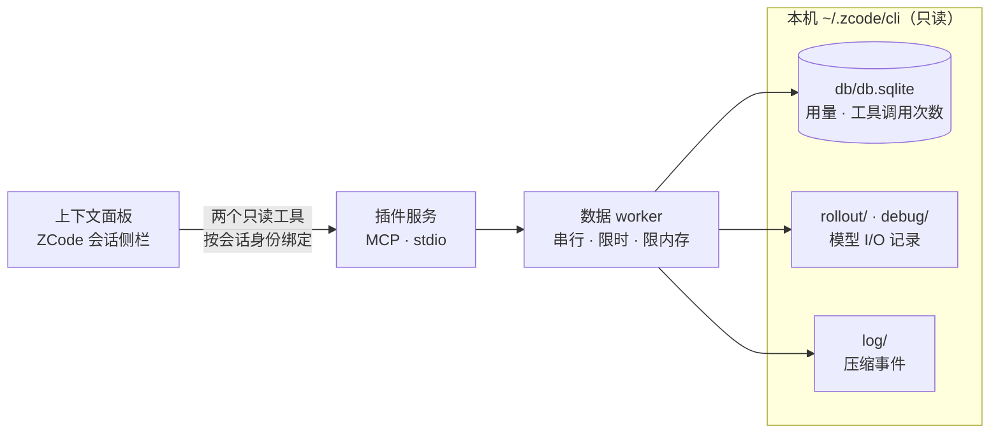

<a name="readme-top"></a>

<div align="center">


<br>
<br>

**在 ZCode 会话侧栏里看清上下文**<br>
每次请求带了什么 · 哪类内容占得最多 · 这一步新进来了什么 · 压缩前后少了什么

<br>

<a href="https://github.com/Kevinzzz6/zcode-context/releases"></a>
<a href="https://github.com/Kevinzzz6/zcode-context/actions/workflows/ci.yml"></a>


<a href="LICENSE"></a>

<br>

[功能](#它能回答什么) &nbsp;·&nbsp; [安装](#安装) &nbsp;·&nbsp; [数字怎么读](#数字怎么读) &nbsp;·&nbsp; [工作原理与隐私](#工作原理与隐私) &nbsp;·&nbsp; [开发](#开发) &nbsp;·&nbsp; [**English**](README.en.md)

</div>

<br>

独立、只读、离线的 ZCode UI 插件，面向 Desktop 本地工作区。它不联网、不调用模型，也不修改 ZCode 的任何设置，只把 ZCode 已经记录在本机的数据整理成一个随会话更新的侧栏面板。

## 它能回答什么

<table>
  <tr>
    <td width="50%" valign="top">
      
      <h4>上下文为什么这么大？</h4>
      每次请求的大小、按类别（系统指令、工具定义、用户消息、助手消息、工具结果）的组成，以及随步骤的变化趋势。
    </td>
    <td width="50%" valign="top">
      
      <h4>压缩前后少了什么？</h4>
      压缩事件、压缩前后两步的跳转，以及被移除的具体内容。「仅变化」只列出新增和移除（需要完整记录，见<a href="#默认记录与完整保留">下文</a>）。
    </td>
  </tr>
  <tr>
    <td width="50%" valign="top">
      
      <h4>这一步新进来了什么？</h4>
      上一步回复之后进入上下文的内容，通常是工具结果，参数和正文可以直接展开。每条消息还标出它从第几轮第几步进入上下文，例如 <code>T4 S17</code>。
    </td>
    <td width="50%" valign="top">
      
      <h4>哪些工具定义白占 token？</h4>
      每个工具定义本会话被调用了几次，以及从未调用的工具定义每次请求占多少。
    </td>
  </tr>
</table>

## 界面一览

从上到下：

<table>
  <tr><th align="left">区域</th><th align="left">内容</th></tr>
  <tr><td nowrap><b>步骤选择</b></td><td><kbd>‹</kbd> <kbd>›</kbd> 或 <kbd>←</kbd> <kbd>→</kbd> 在主请求之间切换；下拉框另列出标题生成、压缩等辅助请求。默认跟随最新，展开内容阅读时暂停跟随，选中历史请求时提示有几个新请求</td></tr>
  <tr><td nowrap><b>请求概览</b></td><td>输入大小、较上一步的变化、实际输入/输出/缓存；按类别的堆叠条与图例；「本轮 / 输入 / 回复」三行摘要</td></tr>
  <tr><td nowrap><b>上下文趋势</b></td><td>每个主请求一根柱，带纵轴、回合带和 ✂ 压缩标记；可切换总量/变化、步骤/轮次；「自适应」按可见范围缩放；悬停查看各类别数值，悬停类别会在各处同步高亮</td></tr>
  <tr><td nowrap><b>上下文浏览器</b></td><td>按类别折叠和分页；对比基线可选上一步、上一轮或更早任一步；「仅变化」只看新增和移除；条目按工具名和关键参数命名，如 <code>Read · src/cache.ts</code></td></tr>
  <tr><td nowrap><b>条目详情</b></td><td>行内展开：工具卡片（参数表、成功/错误）、工具定义的参数表、正文（可读 / Markdown / 原始、复制、查找、分段）</td></tr>
  <tr><td nowrap><b>压缩事件</b></td><td>日志记录的压缩类型、状态、原因和节省量，可跳到压缩前后两步</td></tr>
  <tr><td nowrap><b>用量</b></td><td>次级页面：近 30 天的逻辑用量、每日汇总和最近请求</td></tr>
  <tr><td nowrap><b>关于</b></td><td>次级页面（工具栏 <kbd>ⓘ</kbd>）：版本、作者、许可、源码仓库，以及只读本机数据、不联网的说明</td></tr>
</table>

## 默认记录与完整保留

默认设置下，ZCode 对模型 I/O 记录有**两层丢弃**：

- **消息级**：每次请求只记录**最近 64 条消息**，而长会话的一次请求常有几百条。
- **会话级**：新会话开始记录时，已有的记录文件会被删到只剩最近写入的 2 个——算上当前会话，通常只有最近 3 个会话留有记录，更早会话的数据整个消失。这也是「几个小时前的会话什么都查不到」的原因：不是插件读不到，是记录已经不在了。

插件会如实区分这些情况，不拿缺失的数据去猜：

| | 默认设置 | 打开「完整保留模型 I/O」 |
|---|---|---|
| 更早会话的记录 | ❌ 只保留最近 3 个会话的记录文件，更早的已被删除且无法恢复 | ✅ 持续保留，不再按会话数清理 |
| 请求大小 | ⚠️ 以 provider 上报的实际输入为准，标出已记录部分，其余显示为斜纹的「更早消息（未记录）」 | ✅ 完整的分类估算 |
| 按类别组成 | ⚠️ 只覆盖已记录的消息和工具定义 | ✅ 完整 |
| 「输入」行、新增内容 | ✅ 可用（由入场标记推出） | ✅ 可用 |
| 移除了什么、按类别的变化量 | ❌ 无法得知，界面会说明 | ✅ 可用 |
| 替换内容的正文 Diff | ❌ 不可用 | ✅ 可用（仅限有唯一身份的工具结果和工具定义） |
| 工具调用次数、入场标记 | ✅ 可用 | ✅ 可用 |

<p align="center">
  <br>
  <sub>默认设置下，未记录的更早消息在堆叠条和趋势里以斜纹显示</sub>
</p>

> [!IMPORTANT]
> **建议装好插件就打开「完整保留模型 I/O」，不要等到想回看时再开——默认丢掉的记录无法事后恢复。** 打开方法：ZCode <kbd>设置</kbd> → <kbd>通用</kbd>，找到「完整保留模型 I/O」并开启。开关只对之后发生的请求生效；代价是磁盘占用增长更快：不再按会话数清理，也没有单文件 64 MB 的重置上限。插件只读本机数据，不会自动修改这个设置。

## 安装

**前置条件**

- **ZCode Desktop**：适配基线 3.15.1，需支持官方 UI 插件接口。
- **Node.js 24+**：在系统 PATH 中，终端里 `node -v` 能打印版本即可。它只用于启动插件自带的服务，不需要 npm 或其他构建工具。

### 从插件市场安装（推荐）

1. 打开 <kbd>设置</kbd> → <kbd>插件管理</kbd>，切换到 <kbd>发现</kbd>（Discover）页签。
2. 点击页签右上角的 <kbd>+</kbd> 添加市场。
3. 输入本项目的 GitHub 仓库并确认，市场列表会新增 `zcode-context-marketplace`：

   ```text
   Kevinzzz6/zcode-context
   ```

   填完整地址 `https://github.com/Kevinzzz6/zcode-context` 也可以。
4. 在插件列表找到 **zcode-context** 卡片，点击 <kbd>获取</kbd>（Get）；按钮变为「已安装」即完成，插件默认启用。
5. 重启 ZCode。
6. 打开任意一个会话，在右侧面板点击 <kbd>+</kbd> 新增标签，选择 <kbd>上下文</kbd>。

整个过程不需要克隆仓库，也不需要执行任何 npm 命令。插件安装进 ZCode 的本地缓存，自带服务依赖、worker 和离线页面，运行时不依赖源码目录；卸载与开关在「已安装」页签的插件详情里操作。

> [!NOTE]
> 添加市场时 ZCode 需要从 GitHub 克隆仓库。如果网络要走代理，请设置环境变量 `ZCODE_HTTP_PROXY`（例如 `http://127.0.0.1:7890`）并重启 ZCode。ZCode 只读取这个变量，不读取 `http_proxy`。

<details>
<summary><b>更新</b></summary>

<br>

在 <kbd>设置</kbd> → <kbd>插件管理</kbd> → <kbd>发现</kbd> 中刷新 `zcode-context-marketplace` 市场源；zcode-context 卡片出现「更新」时点击更新，完成后重启 ZCode。当前版本号在「已安装」页签的插件详情里查看。

</details>

<details>
<summary><b>离线安装</b>（无法访问 GitHub 时）</summary>

<br>

1. 在 [Releases](https://github.com/Kevinzzz6/zcode-context/releases) 下载对应版本的 `zcode-context-<版本>-marketplace.zip`；同名的 `.sha256` 文件可用来校验。
2. 解压到任意位置，得到 `zcode-context-marketplace` 目录。
3. 在 <kbd>插件管理</kbd> → <kbd>发现</kbd> → <kbd>+</kbd> 添加市场时选择本地目录，指向解压出的 `zcode-context-marketplace` 目录（其中含有 `marketplace.json`）。
4. 获取、启用、重启，与上面第 4–6 步相同。

</details>

<details>
<summary><b>从源码安装</b>（开发者）</summary>

<br>

```sh
git clone https://github.com/Kevinzzz6/zcode-context.git
cd zcode-context
npm ci
npm run build
```

构建会在仓库根生成 `marketplace.json` 和 `plugins/zcode-context/`，整个仓库根目录此时就是一个市场目录。在 <kbd>插件管理</kbd> → <kbd>发现</kbd> → <kbd>+</kbd> 添加市场时选择本地目录、填仓库根目录的绝对路径即可；改动代码后重新构建，再到市场里刷新并更新插件。完整验证流程见下文[开发](#开发)。

</details>

### 首次打开：授权两个只读工具

插件开关只决定 ZCode 加载插件；面板取数据时要调用插件自带的两个工具，ZCode 对它们照常执行工具权限规则：

- `mcp__plugin_zcode-context_context__get_context_summary`：概览和趋势，有变化时每 3 秒轮询，长时间无变化时逐步放慢到 10 秒
- `mcp__plugin_zcode-context_context__get_context_request`：某一步的内容、对比和正文

> [!IMPORTANT]
> 这两个工具只读，只有面板能调用，模型看不到。如果面板一直显示「读取中」或「读取时间较长」，请在 ZCode 中允许这两个工具（授权按项目保存）。插件不会自行修改权限。

## 数字怎么读

- **估算**：按序列化内容计算，英文和代码约 4 字符 ≈ 1 token，中日韩文字约 1.5 字 ≈ 1 token，用来比较大小和变化，不等于模型的分词结果。带「≈」的都是估算。
- **实际输入**：provider 上报的这次请求的输入 token，包含缓存读取。
- **步序号和回合号**：从当前可读的第一条记录开始计数，不是整个会话的绝对序号。ZCode 会定期重置长会话的记录文件，之后历史会从头开始，趋势图下方会说明。
- **入场标记** `T2 S7`：按消息的绝对位置追溯得到。追到已加载的最早记录、记录缺口、重置或压缩时仍然存在的消息，显示「更早」，不猜步骤。
- **工具调用次数**：来自整个会话的调用记录，包括所选步骤之后的调用和已被压缩掉的调用。读不到调用记录时显示未知，不显示 ×0。
- **压缩**：以日志为准，只读最近 3 天的日志。内容变少不代表发生了压缩，没读到事件也不能证明没有压缩。
- **用量页**：来自 ZCode 数据库的逻辑请求统计，包含标题、压缩等辅助调用，和趋势中的记录分开计算，不做强行对应。

## 工作原理与隐私



- **只读**：不修改 ZCode 的代码、设置、数据库或权限，不运行迁移，数据库连接为只读。
- **离线**：不联网，不调用模型；所有数据留在本机。
- **会话隔离**：每次读取都按宿主传入的会话身份绑定，拿不到有效身份时明确报错，不会去读别的会话。面板属于打开它的会话，不会因为同一工作区里其他会话发消息而切换。
- **安全渲染**：捕获的 HTML 不会执行，正文按纯文本或受限的 Markdown 显示。

## 配置

默认读取 `~/.zcode/cli` 下的数据。需要时在插件配置里修改：

| 选项 | 默认值 | 用途 |
|---|---|---|
| `dataRoot` | `~/.zcode/cli` | 指向其他 CLI 数据目录（含 `db/db.sqlite`、`rollout/`、`debug/`、`log/`） |
| `dbPath` | `<dataRoot>/db/db.sqlite` | 数据库单独放置时设置 |

两者都需为绝对路径，支持 `~/`。

## 开发

```sh
npm ci
npm run check        # 语法与清单检查
npm test             # 单元测试
npm run build        # 构建 dist/、plugins/zcode-context/ 与根目录市场
npm run smoke        # 构建产物 + 真实 MCP stdio 通信
npm run verify       # 以上全部，结果写入 output/verification
```

| 命令 | 用途 |
|---|---|
| `npm run fixture:ui` | 合成的多轮会话（工具调用、标题请求、自动压缩），打开 <http://127.0.0.1:4175>；`FIXTURE_TAIL=12` 模拟默认的只记录最近消息；`/append?session=sess_A` 模拟新请求到达 |
| `npm run preview:session -- <sessionId>` | 用构建产物只读地预览一个真实会话，打开 <http://127.0.0.1:4177>，无需安装插件 |
| `npm run preview` | 演示数据页面，打开 <http://127.0.0.1:4173/?demo=1> |
| `npm run fixture:browser` + `npm run test:browser -- <playwright/index.mjs 的绝对路径>` | 浏览器交互回归（25 组），使用已有的 Playwright 和本机 Chrome，不下载浏览器 |

浏览器测试验证官方 App/AppBridge 握手、真实 stdio/SQLite 和双会话隔离，但不代替在 ZCode 桌面侧栏中的验收。README 的头图和截图外框由 [`docs/images/src/render.sh`](docs/images/src/render.sh) 从原始截图生成。

## 当前状态

- ✅ 0.3.x 已用真实会话（约 60 万 token、默认记录模式）在只读预览中验证，单元测试与浏览器交互测试全部通过。
- ⏳ 0.3.x 在 ZCode 桌面侧栏中的验收尚未完成；0.2.0 曾完成基础 Electron 接入。
- ⚠️ 上游内部存储格式变化时，读取适配可能需要更新。

## 文档

| 文档 | 内容 |
|---|---|
| [更新日志](CHANGELOG.md) | 每个版本的变化 |
| [产品决策与取舍](docs/decisions.md) | 刻意没做的功能和原因 |
| [架构](docs/architecture.md) | 身份绑定、数据来源、隔离与限制 |
| [交接与接续步骤](docs/handoff.md) | 当前版本的修复记录与后续步骤 |
| [桌面验收](docs/desktop-acceptance.md) | 桌面侧栏的验收清单，只在隔离的 ZCode 副本中进行 |
| [验证记录](docs/verification.md) | 已执行的检查与结果 |
| [与 dsh-context 的对比](docs/dsh-comparison.md) | 界面与功能差距评估 |

<br>

<div align="center">

<sub>MIT 许可 · 实现为原创，产品方向受 <a href="https://github.com/bowenliang123/dsh-context">dsh-context</a> 启发</sub><br>
<sub><a href="#readme-top">回到顶部 ↑</a></sub>

</div>
